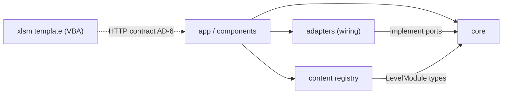
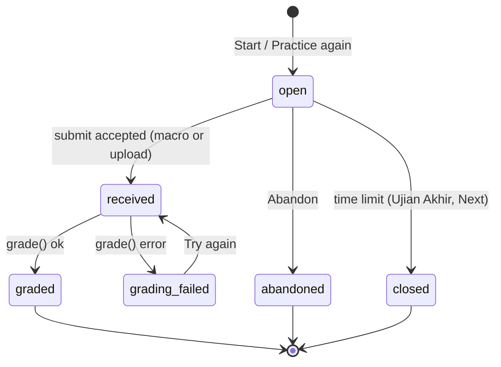
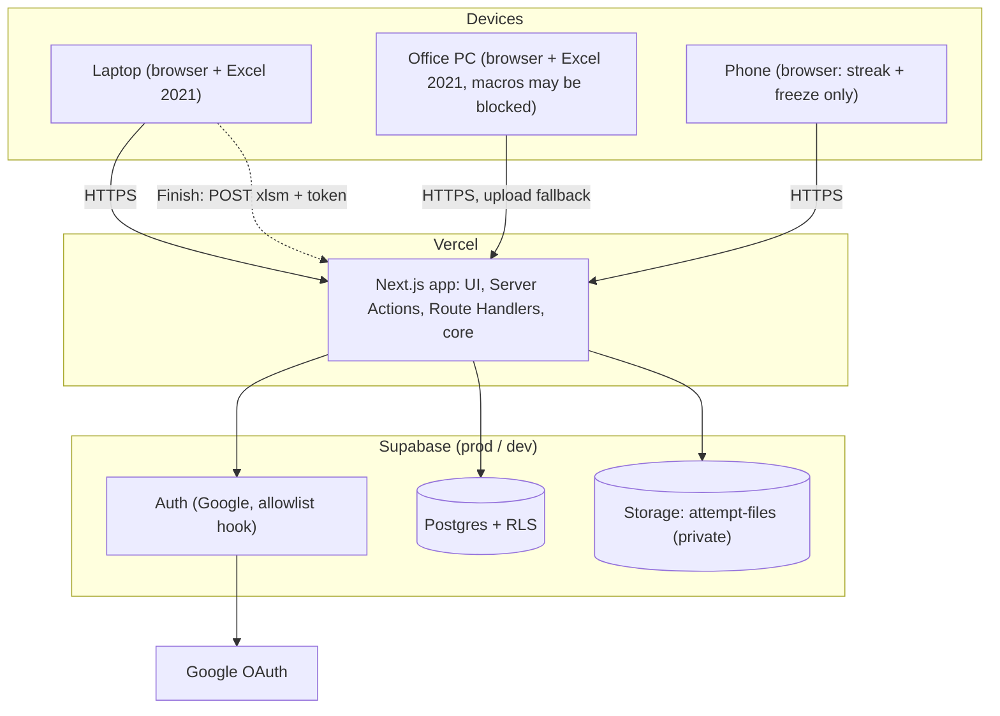
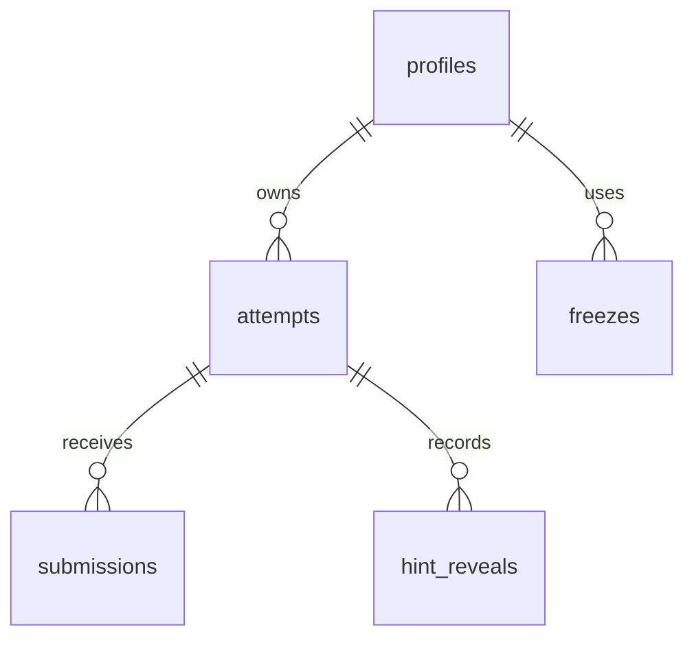

# Architecture Spine — WORKING HARD with EXCEL

## Design Paradigm

**Modular monolith, hexagonal core, level content as plug-ins.** One Next.js app deployed as one unit.

| Layer | Path | Holds | May import |
| --- | --- | --- | --- |
| Core (domain + use cases) | `src/core/` | Attempt state machine, grading + checker primitives, scoring, progress derivation (unlocks, pips, streak, freezes, records, Tips collection), ports | `src/core/**`, `zod` |
| Content (plug-ins) | `src/content/` | One `LevelModule` per level + the level registry; Indonesian content strings | `src/core/content` types, `zod` |
| Adapters | `src/adapters/` | Supabase repositories + storage, WorkbookIO (xlsm), auth, clock | core ports, vendor SDKs |
| App (delivery) | `src/app/`, `src/components/` | Next.js routes, Server Actions, Route Handlers, shadcn UI | core use cases, content registry, adapters (wiring only) |
| Excel client | `assets/templates/` | The one `.xlsm` exam template (Instructions sheet, Finish button, VBA) | server contract (AD-6) |



Arrows are the only allowed import directions; `core` imports nothing outside itself.

## Invariants & Rules

### AD-1 — Pure core, no framework imports [ADOPTED]

- **Binds:** all
- **Prevents:** grading, streak or attempt rules re-implemented in route handlers or components and drifting between the macro path, the upload path and the UI.
- **Rule:** `src/core/**` imports only `src/core/**` and `zod` — never `next`, `react`, `@supabase/*`, `node:*`, or network/IO. Use cases receive ports (repositories, WorkbookIO, clock) as arguments. Enforced by an ESLint `no-restricted-imports` rule on `src/core`.

### AD-2 — Levels are plug-ins behind one `LevelModule` contract [ADOPTED]

- **Binds:** CAP-1, CAP-6, CAP-7, CAP-8, CAP-9, CAP-13, CAP-15
- **Prevents:** adding a level changing the engine, grading, streak or Level Map UI; per-level special cases in engine code.
- **Rule:** each level is `src/content/levels/<NN>-<slug>/` exporting a `LevelModule` (type in `src/core/content`): `id`, `number`, curriculum `name`, `phase` (`v1` | `next`), `hintQuota`, items (5 practices + 1 Test), scenario bank (≥10 in V1), `generate(seed, scenario)` → data + questions + answer key, per-question ordered hints, per-question Tips. `src/content/levels/index.ts` is the only list of levels and the side track (`kind: 'side-track'`); the Level Map and gates read it. A `phase: 'next'` entry renders Under Construction and exposes no Start. Engine code never branches on a level id.

### AD-3 — Grading is a pure function of the stored snapshot [ADOPTED]

- **Binds:** CAP-4, CAP-5, CAP-7, CAP-9, CAP-11, CAP-21
- **Prevents:** macro and upload scoring differently; a re-grade or History view disagreeing with the first result; each level inventing its own "typed number" detection.
- **Rule:** at Start the attempt persists a snapshot: scenario id, seed, questions with integer `points` (sum = 100, validated at module load), answer key, `content_version`. `grade(snapshot, WorkbookReading, hintsUsed) → Result` lives in core, deterministic (no clock, random or IO). Questions reference checker primitives from `src/core/grading/checkers` by name (e.g. formula present, uses required functions, value equals key, not hard-coded); level modules declare checks, never implement them. Score = Σ points of correct questions − 5 × `hintsUsed` (count of `hint_reveals`), floor 0. The stored `Result` holds, per question, `correct`, points awarded, the resolved Indonesian `reasonText` and the full Tip (title, body, keys); Results, History and the Tips collection render from it, never by re-reading content.

### AD-4 — One WorkbookIO port; generation patches the template [ADOPTED]

- **Binds:** CAP-2, CAP-3, CAP-4, CAP-5, CAP-16, CAP-18
- **Prevents:** two units writing or reading workbooks with different libraries — lost Finish button or VBA, mis-parsed formulas; two units fingerprinting the template differently, or a fingerprint that changes when Excel saves the file.
- **Rule:** only `src/adapters/workbook` touches `.xlsm`/`.xlsx` bytes. Templates are kept per version as `assets/templates/exam.v<N>.xlsm` with a registry of VBA fingerprints; the attempt records the `template_version` that `generate()` returns with the bytes. A released template version is never modified: a change ships as a new version, registered before it becomes current. Generation unzips the current template, writes the data and Instructions cells into the sheet XML, sets custom document properties `WHE_AttemptToken`, `WHE_ServerUrl`, `WHE_TemplateVersion`, and re-zips; the workbook is never re-serialized through a spreadsheet library. Reading returns a `WorkbookReading`: per cell normalized formula text (shared formulas expanded), cached value and type; custom properties; per VBA module, the SHA-256 of its normalized source. Normalized source: the module's bytes in `xl/vbaProject.bin` (an MS-CFB container) from the `dir` stream's MODULEOFFSET, decompressed per MS-OVBA §2.4.1 and kept as bytes, never decoded as text; CRLF and lone CR become LF; lines starting with `Attribute VB_` are dropped; trailing spaces and tabs are stripped; trailing empty lines are dropped; lines are joined with LF and no final LF. Modules are keyed by MODULENAMEUNICODE. The registry pins, per template version, the hashes of the template's modules whose normalized source is not empty (v1: `modFinish`); only the adapter produces these values, from the committed `.xlsm`, as lowercase hex, recomputed in CI. A file matches a version when its VBA project is present and readable and every pinned module is present with an equal hash; modules the template does not pin, such as a new sheet's empty module, are ignored. Identity checks never compare the bytes of `xl/vbaProject.bin`. The generated file is stored once per attempt; re-download serves those bytes.

### AD-5 — Attempt lifecycle has one state machine and one writer

- **Binds:** CAP-2, CAP-3, CAP-4, CAP-9, CAP-10, CAP-11, CAP-14, CAP-19, CAP-20
- **Prevents:** two code paths transitioning attempts differently; two open attempts across devices; abandoned attempts being graded or counted.
- **Rule:** only `src/core/services/attempts` changes `attempts.status`, following the diagram below. The database enforces at most one attempt per user in `open`, `received` or `grading_failed` (partial unique index). *Practice again* creates a new attempt for the same item with the same lifecycle. Hint reveals are inserted only while `open`, in one transaction that checks the per-attempt quota (`LevelModule.hintQuota`); `hint_reveals` is unique per (attempt, question, hint index). Grading commits with a compare-and-set on `status = 'received'`, so concurrent graders cannot both write. Only `graded` attempts feed progress (AD-7).



### AD-6 — Submission identity and rejection codes are one shared contract

- **Binds:** CAP-3, CAP-4, CAP-18, CAP-20
- **Prevents:** the VBA template, the API and the web UI disagreeing on why a file was refused; the macro path authenticating differently from upload.
- **Rule:** macro (`POST /api/submissions/macro`, token-authenticated, no session) and upload (`POST /api/submissions/upload`, session) call one use case `submit(bytes, channel)`, with this decision order: (1) not an OOXML package, or a workbook the reader cannot read → `NOT_EXCEL`; (2) an Excel workbook that is not a macro-enabled `.xlsm` (by the main part's content type: `.xlsx`, `.xlsb`, `.xltm`, `.xlam`), `WHE_AttemptToken` missing or malformed, or the macro's `X-Attempt-Token` header ≠ the file's token → `IDENTITY_ALTERED`; (3) the attempt is found by the file's token on both channels; none → `NOT_THIS_ATTEMPT`; (4) the VBA fingerprint does not match that attempt's recorded `template_version` (AD-4; a missing or unreadable VBA project never matches) → `IDENTITY_ALTERED`; (5) attempt `graded` → `ALREADY_GRADED`; `abandoned` or `closed` → `ATTEMPT_CLOSED`; `received`/`grading_failed` → accepted as an idempotent duplicate (file not replaced); `open` → accepted. The macro also sends the token as header `X-Attempt-Token`. The `WHE_TemplateVersion` property never selects the version. Codes are an enum in `src/core/submission/rejection-codes.ts`; the VBA maps codes to its message boxes, the web maps them to the EXPERIENCE.md message set. Adding a code bumps `WHE_TemplateVersion`.

### AD-7 — Progress is derived from history, never stored [ADOPTED]

- **Binds:** CAP-1, CAP-8, CAP-9, CAP-10, CAP-11, CAP-12, CAP-19, CAP-21
- **Prevents:** streak, records or unlocks drifting when results arrive by macro, upload, re-grade, *Practice again* or another device.
- **Rule:** unlocked levels, practice pips, Test gate, streak, freezes left, records (best `received_at − started_at` per item, any score) and the Tips collection are computed by core functions from `graded` attempts + `freezes` + `profiles.time_zone`. No table stores a streak, record, unlock or count. A cache is allowed only if it can be rebuilt from those tables (Deferred).

### AD-8 — Server time and one fixed day boundary

- **Binds:** CAP-10, CAP-11, CAP-14, CAP-20
- **Prevents:** laptop, office PC and phone disagreeing on "today"; durations measured on a client.
- **Rule:** every timestamp is `timestamptz` set by the server or DB. Duration = `received_at − started_at`. A graded attempt counts for the local date of its `received_at` in `profiles.time_zone` (IANA, captured from the browser at first sign-in, immutable). A freeze is a row (`freezes.local_date` = today in that zone), created only before that day ends; at most 2 per ISO week (Mon–Sun) in that zone.

### AD-9 — Data access is server-only; RLS denies by default

- **Binds:** all, CAP-17
- **Prevents:** browser and server reading or writing the same tables under different rules; the service-role key reaching a client bundle.
- **Rule:** the browser never calls Supabase tables or Storage. Reads and writes go through Server Components, Server Actions and Route Handlers into `src/adapters/supabase` repositories using the user's session (`@supabase/ssr`). Every table has RLS on with owner-only policies; the one exception is `app_meta`, which holds no user data and grants `select` only to `anon` and `authenticated` so the unauthenticated `/health` can show the schema version. The service-role client exists only in the macro submission and grading path. Generated and submitted files live in the private bucket `attempt-files`, reached through short-lived signed URLs. Only the allowlisted Google account gets a session: Supabase *Before User Created* hook rejects any other email, and the auth callback re-checks `ALLOWED_EMAIL`.

### AD-10 — Content lives in code and is versioned with the app [ADOPTED]

- **Binds:** CAP-6, CAP-7, CAP-8, CAP-13, CAP-14
- **Prevents:** the scenario bank split between DB and code; open attempts graded against content that changed after Start.
- **Rule:** V1 scenarios, question specs, hints and Tips are TypeScript/JSON under `src/content`; there are no content tables. Content changes ship with a deploy and bump the module's `content_version`; grading uses the attempt snapshot (AD-3). Runtime AI scenarios (Next) must produce the same `Scenario` shape and pass the generator schema check before an attempt starts.

### AD-11 — The exam screen learns state by polling

- **Binds:** CAP-3, CAP-4, CAP-5, CAP-20
- **Prevents:** one surface using Realtime and another polling, so the exam screen and the Attempt Card disagree.
- **Rule:** `GET /api/attempts/:attemptId/status` returns status, elapsed seconds and, when graded, the result id. The exam screen polls every 2 s while the attempt is `open`, `received` or `grading_failed`, moves to Results on `graded`, and shows the slow-grading message after 15 s in `received`. Grading runs in `after()` from the submit request. No websockets or Supabase Realtime in V1.

### AD-12 — Motion is CSS-only with a static frame [ADOPTED]

- **Binds:** Level Map, Results and Dashboard motion (DESIGN.md, EXPERIENCE.md › Interaction Primitives)
- **Prevents:** surfaces pulling different animation stacks and fallbacks; heavy 3D assets on the phone.
- **Rule:** motion uses CSS transitions/keyframes, CSS scroll-driven animations (`animation-timeline`) and inline SVG only — no three.js, WebGL, framer-motion, GSAP, Lottie, video or image sequences, and no raster assets in scenes. Every scroll scene sits inside `@supports (animation-timeline: scroll())` and has a static frame. One `useMotionPreference()` hook combines `prefers-reduced-motion`, the Settings switch, and (for scenes) `navigator.connection.saveData` and `deviceMemory ≤ 4`.

### AD-13 — Environments are paired; the workbook knows its server

- **Binds:** CAP-3, CAP-12, CAP-16, CAP-17
- **Prevents:** a Preview-generated file posting to Production; schema drift between environments; secrets in the repo or a workbook.
- **Rule:** Vercel Production (`main`) ↔ Supabase project `prod`; Vercel Preview (other branches) and local dev ↔ Supabase project `dev`. Schema changes only as SQL migrations in `supabase/migrations`, applied to `dev` then `prod`; no dashboard schema edits. Each workbook carries `WHE_ServerUrl` of the environment that generated it, and the macro posts only there. Secrets live only in Vercel environment variables and `.env.local`; the workbook carries no key or password.

## Consistency Conventions

| Concern | Convention |
| --- | --- |
| Naming | DB `snake_case`, plural tables (`profiles`, `attempts`, `submissions`, `hint_reveals`, `freezes`); TS `camelCase` / `PascalCase` types; level folders `NN-slug` (`03-hitung-bersyarat`); item ids `L03-P5`, `L03-T`, `UA`; URL segments kebab-case. |
| IDs | Row ids `uuid` (`gen_random_uuid()`); attempt token = 32 random bytes, base64url, unique, never the row id. |
| Dates | `timestamptz` (UTC) in DB; ISO 8601 in JSON; local dates only via AD-8. |
| API envelope | `{ ok: true, data }` / `{ ok: false, code, detail? }`; `code` from a core enum in `SCREAMING_SNAKE_CASE`; the UI maps codes to copy and never shows server text. |
| Validation | `zod` at every boundary: route input, `LevelModule` load (points sum 100, ≥10 scenarios in V1, no Microsoft 365-only function names in questions, hints or Tips — list in `level-curriculum.md`), AI output (Next). |
| Copy | UI chrome English inside components; Indonesian content in `src/content`; Indonesian system messages in `src/messages/id.ts`; Excel names verbatim English. No i18n framework. |
| Auth & session | `@supabase/ssr` cookie session refreshed in `proxy.ts`, refresh lifetime ≥30 days (CAP-17); every Server Action and Route Handler checks the session except `/api/submissions/macro` (token, AD-6). |
| Preferences | Theme and Reduce motion are per-device cookies, read server-side to set `data-theme` and motion before first paint; header toggle and Settings write the same cookie. |
| Storage paths | `attempt-files/<attemptId>/generated.xlsm`; `attempt-files/<attemptId>/submission-<n>.<ext>` (n from 1, first accepted file is graded). |
| Device gating | Phone = `(pointer: coarse) and (max-width: 1023px)`: Start and *Practice again* show the phone message and call nothing (CAP-12). |
| Logging | Server logs JSON with `attemptId`, `channel`, `code`; never file bytes, tokens or emails. To match a log line to a token, a log may carry `tokenSha256` (the first 12 hex of the token's SHA-256), never the token itself. |
| Testing | Vitest; every `LevelModule` ships golden fixtures (`__fixtures__/correct.xlsm`, `typed-values.xlsm`) graded in CI; one parity test grades the same fixture through the macro and upload channels; the VBA fingerprint of each committed template is recomputed against the registry and against an Excel-saved copy (S3 `s3-excel2021.xlsm`, saved after adding a sheet and opening the VBA editor); the MS-OVBA decompressor has a golden test for a module larger than one 4096-byte chunk. |

## Stack

| Name | Version |
| --- | --- |
| Node.js | 24.x (pin major only) |
| Next.js (App Router), starter `create-next-app -e with-supabase` | 16.4.x |
| React | 19.3.x |
| TypeScript | as pinned by the starter |
| Tailwind CSS | 4.3.x |
| shadcn (CLI) | 4.22.x |
| @supabase/supabase-js | 2.118.x |
| @supabase/ssr | 0.12.x |
| Supabase CLI | 2.121.x |
| Supabase (Postgres, Auth with Google, Storage) | managed, free plan, projects `prod` + `dev` |
| Vercel | managed (Production + Preview) |
| jszip | 3.10.x |
| fast-xml-parser | 5.11.x |
| zod | 4.6.x |
| Vitest | 5.0.x |
| Excel client | Excel 2021 desktop, VBA |

## Structural Seed





```text
src/
  core/            # AD-1: content types, grading + checkers, attempts service, progress, submission, ports
  content/
    levels/        # AD-2: 01-fondasi … 04-cari-data (v1), 05…09 + side track (next), index.ts registry
  adapters/
    supabase/      # repositories, storage, auth callback
    workbook/      # AD-4: template patching + reading
  app/             # routes, Server Actions, /api/submissions/{macro,upload}, /api/attempts/[id]/status
  components/      # shadcn + brand components (DESIGN.md)
  messages/        # id.ts system messages
assets/templates/  # exam.xlsm (+ VBA source exported for review)
supabase/migrations/
```

## Capability → Architecture Map

| Capability | Lives in | Governed by |
| --- | --- | --- |
| CAP-1 level map & unlocks | `content/levels/index.ts`, `core/progress` | AD-2, AD-7 |
| CAP-2 Start → `.xlsm` | `core/services/attempts`, `adapters/workbook` | AD-3, AD-4, AD-5, AD-13 |
| CAP-3 Finish macro | `assets/templates/exam.xlsm`, `/api/submissions/macro` | AD-4, AD-6, AD-11, AD-13 |
| CAP-4 upload fallback | `/api/submissions/upload`, `core/submission` | AD-6 |
| CAP-5 grading & reasons | `core/grading` | AD-3 |
| CAP-6 fresh data | `LevelModule.generate` | AD-2, AD-10 |
| CAP-7 hints | `core/services/attempts` (`hint_reveals`), `LevelModule` hints | AD-3, AD-5 |
| CAP-8 Tips + collection | `LevelModule` Tips, `core/progress` | AD-2, AD-7 |
| CAP-9 Test gate & retake | `core/progress`, attempts service | AD-5, AD-7 |
| CAP-10 streak & freeze | `core/progress`, `freezes` | AD-7, AD-8 |
| CAP-11 records | `core/progress` | AD-7, AD-8 |
| CAP-12 devices & phone | Supabase cloud state, device gating | AD-7, AD-9, conventions |
| CAP-13 Level 5–9 (Next) | new `LevelModule`s | AD-2, AD-10 |
| CAP-14 Ujian Akhir (Next) | `LevelModule` + `closed` state | AD-2, AD-5, AD-8 |
| CAP-15 side track (Next) | registry entry `side-track` | AD-2 |
| CAP-16 Setup Guide | `app` page, template location | AD-4, AD-13 |
| CAP-17 Google sign-in | `adapters/supabase` auth, `proxy.ts` | AD-9 |
| CAP-18 file ownership | `core/submission` | AD-4, AD-6 |
| CAP-19 Practice again | attempts service | AD-5, AD-7 |
| CAP-20 open attempt | attempts service, status endpoint | AD-5, AD-11 |
| CAP-21 History | `core/progress`, stored `Result` | AD-3, AD-7 |

## Required Spikes (before content epics)

| Spike | Must prove | If it fails |
| --- | --- | --- |
| S1 — template patch | The patched `exam.xlsm` opens in Excel 2021 with the Finish button and VBA intact | Fall back to a Python/openpyxl WorkbookIO adapter (same port) |
| S2 — formula reading | Formula text (incl. shared formulas) and cached values are read correctly from a file saved by Excel 2021 | Same fallback as S1 |
| S3 — macro POST | Finish posts the saved file to `WHE_ServerUrl` over HTTPS from the laptop and reports status; the posted file's VBA fingerprint matches the registry, also after adding a sheet and opening the VBA editor | Upload stays the only path until fixed (CAP-4) |

## Deferred

- **Upload size limit and its message** — epic 2; Vercel rejects request bodies over 4.5 MB before `submit()` runs.
- **VBA HTTP on the office PC** (TLS, proxy, policy) — epic 2; on the laptop S3 settled `MSXML2.ServerXMLHTTP.6.0`, `application/octet-stream`, and the byte array passed by value; the contract (AD-6, AD-13) is fixed.
- **Pivot grading** (Next) — layered approach in `pivot-grading.md`, spiked before Level 7.
- **AI scenario adapter** (Next) — not wired in V1 (no runtime AI); server-only key; must satisfy AD-10 schema check.
- **Ujian Akhir 60-minute close** (Next) — how the server closes an attempt at 60 minutes (scheduled job vs check on next request); state already exists (AD-5).
- **Derived-progress cache** — only if Dashboard reads exceed ~300 ms; must stay rebuildable (AD-7).
- **Backups / export** — revisit before relying on more than a month of real data; the free plan has no point-in-time recovery.
- **Supabase free-plan pause** after 7 idle days — restore manually; revisit a keep-alive if it happens more than once.
- **Rate limiting and observability beyond Vercel logs** — single user; revisit if the URL is shared.
- **Full column lists, indexes beyond AD-5, custom domain** — owned by the code and migrations.
